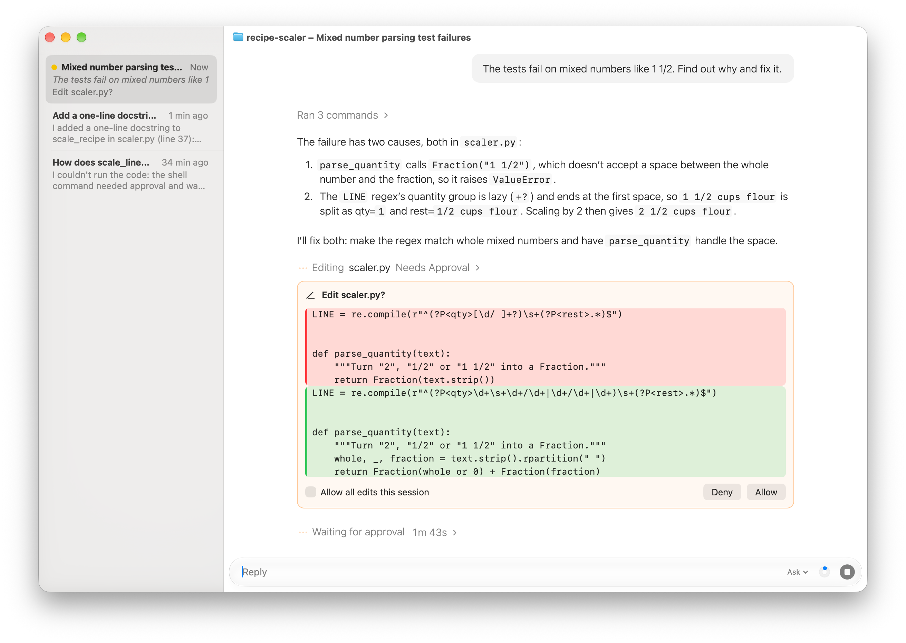
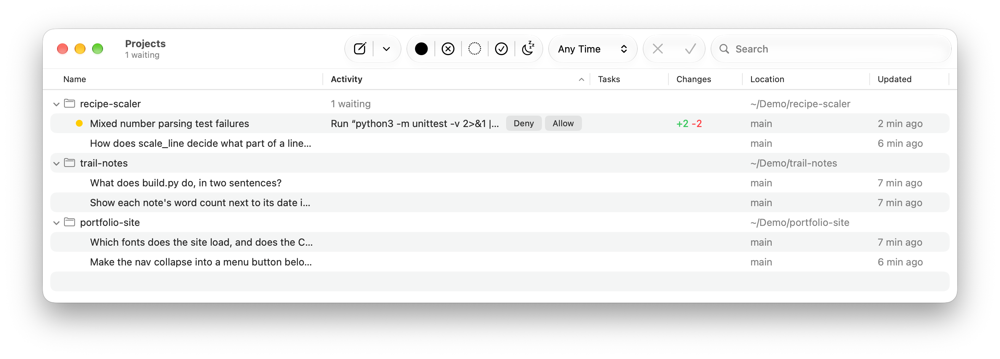
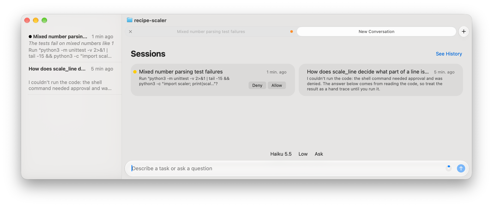

<p align="center"></p>

<h1 align="center">Theseus</h1>

Theseus is the best native Mac app for [Claude Code](https://code.claude.com). If `claude` works in your terminal, Theseus works: it uses that CLI's login and plan.



## Design

The official app is a great web app, but not a great Mac app. It's totally possible to create a great native Mac client that meets and exceeds the official app in functionality using the `claude` CLI as an engine.

## Features

- Near parity with official app's transcript rendering
- One window, one project - like XCode or VSCode.
- Conversations in tabs, in addition to the sidebar.
- Global projects window
- New tab page & History akin to Safari





## Requirements

- macOS 26 or later
- Claude Code installed and logged in, with `claude` on your login shell's PATH
- To build: Xcode 26 or later and [XcodeGen](https://github.com/yonaskolb/XcodeGen) (`brew install xcodegen`)

## Download

Get the notarized DMG from the [latest release](https://github.com/johnsusek/Theseus/releases/latest) and drag Theseus to Applications.

## Build

```bash
git clone https://github.com/johnsusek/Theseus.git
```

```bash
cd Theseus && xcodegen generate && open Theseus.xcodeproj
```

Set `DEVELOPMENT_TEAM` in `project.yml` to your own team ID (or pick your team under Signing & Capabilities), then build and run the Theseus scheme. Xcode fetches ClaudeEngine and [Highlightr](https://github.com/raspu/Highlightr) from GitHub.

To work on ClaudeEngine at the same time, clone it beside this folder. `scripts/install.sh` builds a Debug copy against that checkout instead of the GitHub one, replaces `/Applications/Theseus.app` and relaunches it:

```bash
git clone https://github.com/johnsusek/ClaudeEngine.git ../ClaudeEngine
```

```bash
scripts/install.sh
```

## Tests

```bash
xcodebuild -project Theseus.xcodeproj -scheme Theseus -destination 'platform=macOS' test
```

The `TheseusTests` target compiles the transcript, Markdown, sidebar and Projects models straight into the test bundle, so the tests run without launching the app or a CLI.

## License

MIT. See [LICENSE](LICENSE).
