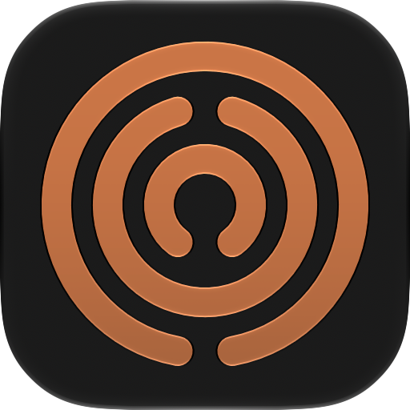

<p align="center"></p>

<h1 align="center">Theseus</h1>

Theseus is a native Mac app for [Claude Code](https://code.claude.com). It runs the `claude` CLI you already have installed and logged in, one process per conversation, and draws the conversation in AppKit. It is an independent project, not made or endorsed by Anthropic.

> [!NOTE]
> Theseus has no login and never asks for an account, password or API key. If `claude` works in your terminal, Theseus works: it uses that CLI's login and plan, and makes no network requests of its own.

The app talks to the CLI through [ClaudeEngine](https://github.com/johnsusek/ClaudeEngine), a Swift library for Claude Code's stream-json and control protocols.

## Features

- Each conversation is a window, and windows group as tabs. The transcript is one TextKit 2 text view, so selection and Find (⌘F) cover the whole conversation.
- Permission requests, questions, plans and the next-step box appear as cards inside the transcript, where you answer them.
- The status row under the prompt switches model, effort and permission mode. It also shows how full the context is and opens lists of running agents and changed files.
- Window > Projects (⇧⌘0) lists every session in `~/.claude/projects` by project, with a dot for unread ones. A session waiting on you gets Allow and Deny buttons in its row, so you can answer it without opening it.
- A new tab opens on a start page with the project's recent sessions; the sidebar lists them with subsessions under their parent, and View > Sidebar Configuration sets what each row shows.
- Code blocks are syntax-highlighted and have Copy, and shell blocks have Run, which opens the command in Terminal.
- If a session is already running in the Claude desktop app or a terminal, Theseus follows it read-only instead of starting a second process on it.

## Requirements

- macOS 26 or later
- Claude Code installed and logged in, with `claude` on your login shell's PATH
- To build: Xcode 26 or later and [XcodeGen](https://github.com/yonaskolb/XcodeGen) (`brew install xcodegen`)

## Download

Get the notarized DMG from the [latest release](https://github.com/johnsusek/Theseus/releases/latest) and drag Theseus to Applications.

## Build

```bash
git clone https://github.com/johnsusek/Theseus.git
```

```bash
cd Theseus && xcodegen generate && open Theseus.xcodeproj
```

Set `DEVELOPMENT_TEAM` in `project.yml` to your own team ID (or pick your team under Signing & Capabilities), then build and run the Theseus scheme. Xcode fetches ClaudeEngine and [Highlightr](https://github.com/raspu/Highlightr) from GitHub.

To work on ClaudeEngine at the same time, clone it beside this folder. `scripts/install.sh` builds a Debug copy against that checkout instead of the GitHub one, replaces `/Applications/Theseus.app` and relaunches it:

```bash
git clone https://github.com/johnsusek/ClaudeEngine.git ../ClaudeEngine
```

```bash
scripts/install.sh
```

## Tests

```bash
xcodebuild -project Theseus.xcodeproj -scheme Theseus -destination 'platform=macOS' test
```

The `TheseusTests` target compiles the transcript, Markdown, sidebar and Projects models straight into the test bundle, so the tests run without launching the app or a CLI.

## License

MIT. See [LICENSE](LICENSE).
